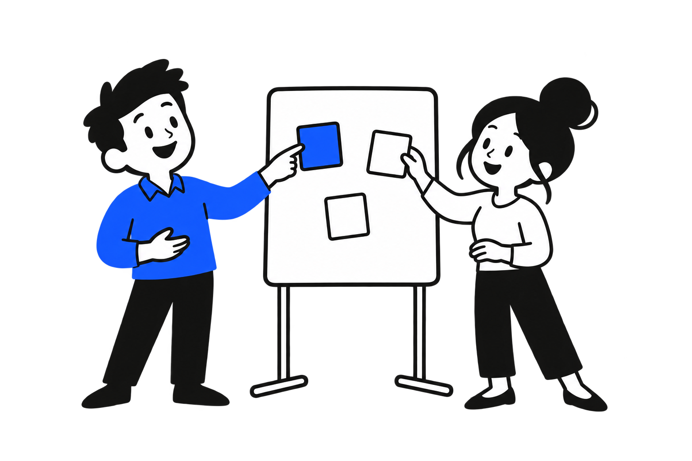

# Duoquill

Blue ideas. Clear stories. A collection for presentations, product pages and everyday visual thinking.



[Browse the gallery](https://ken-pan.github.io/duoquill/) · [Download the complete pack](https://github.com/Ken-pan/duoquill/releases/latest) · [License scope](ASSET_LICENSES.md)

92 scenes (1536 × 1024), 100 spot illustrations (1254 × 1254), and 12 characters (1024 × 1536). Original image bytes are preserved, with SHA-256 hashes in manifest.json. Transparent raster artwork, ready for slides, websites, notes and apps. The gallery supports search, group filters, light/dark/checkered previews and individual downloads. Filter to 24 images or fewer to download a smaller PNG ZIP. Smaller ZIPs include a PNG-only catalog, generation records, CC0 and MIT notices; only one runs at a time. The gallery can also recolor the blue pigment without changing the original files.

## Use and licenses

The artwork is **CC0 1.0 Universal**, to the extent Ken Pan holds rights to dedicate. Commercial use and closed-source projects are welcome; attribution is optional. Gallery code and scripts are **MIT**. Bundled dependencies retain their notices. Read [ASSET_LICENSES.md](ASSET_LICENSES.md), [LICENSE](LICENSE) and [LICENSE-CODE](LICENSE-CODE) for the full scope.

These images were generated with OpenAI's image generation tool and curated by Ken Pan. AI outputs may not be unique or copyrightable everywhere; third-party rights are not cleared by this dedication. Generation records and original hashes are in [provenance/generation.json](provenance/generation.json). No app source, private documents, extracted portfolio cases or style-reference images are included.

The original blue artwork is preserved. Some pale edges look best on a light background. Recoloring changes blue pigment; it does not remove those edges.

## Run locally

Use Node.js 22.14 or newer. Clone or extract the source ZIP, then run:

```sh
npm ci
npm run check
npm test
npm run build
npm run serve
```

Open http://127.0.0.1:4400. Serve over HTTP; opening index.html directly with file:// cannot load the catalog. The gallery uses local files and works without a provider API key, account, telemetry or image uploads. The hosting provider may maintain access logs.

`npm run package` creates a ZIP, source manifest and SHA256SUMS in release/v<VERSION>/. The ZIP contains originals, metadata, licenses and gallery source. It excludes installed dependencies, build output, secrets and Git history. Verify each asset against manifest.json or run the checks above. Build and packaging refuse uncataloged artwork and private content; existing release outputs are preserved. Color-adjusted downloads are generated in your browser and are not the original bytes.

## 中文

Duoquill 是独立发布的素材库：204 张原创 AI 生成素材。图片按 CC0 1.0 在作者持有权利范围内开放，可用于商业和闭源项目，无须署名；图库代码按 MIT 开源。原图、生成记录和校验值均保留。AI 生成素材不保证独占，也不保证在所有地区受著作权保护；第三方商标、肖像等权利仍需按具体用途判断。部分浅色边缘适合浅色背景，改色不会自动去除这些边缘。

Contributions and rights requirements: [CONTRIBUTING.md](CONTRIBUTING.md). Security reporting: [SECURITY.md](SECURITY.md).

## Name change

Duoquill was previously published as Blue & Black. Version 1.0.2 changes the public name and links; the original artwork and asset IDs are identical. Old GitHub repository links redirect to this repository. The gallery now lives at https://ken-pan.github.io/duoquill/.
